<!--
Fuente del PDF de entrega del segundo parcial. Mismo formato que DOCUMENTACION_Parte1.md (portada con logos, índice y capturas embebidas).
Antes de exportar: reemplazar todos los <<COMPLETAR>>.
En el Drive tiene que haber un ÚNICO documento con todos los links (Git, video, diagramas si hay).
-->

 

# DOCUMENTACIÓN - Parte 2

**Desarrollo de Sistemas Web (Back End) — 2° cuatrimestre 2026 — Segundo Parcial**

**Caso 2: Distribución de Pedidos — “FreshRoute”** (FreshRoute B2B — logística de distribución refrigerada)

**Empresa de Desarrollo: LosBuleanos**

**Integrantes:**

- Nicolás Zalazar
- Laura Olivera
- Christian Albornoz
- Laura Belén Blanco
- Fernando Guevara

**Nombre del documento / carpeta Drive:** `DSWB_2A_grupo17-parcial2_2C26`

---

## 1. Links

| Recurso | Link |
|---|---|
| Carpeta Drive (`DSWB_2A_grupo17-parcial2_2C26`) | <<COMPLETAR>> |
| Repositorio GitHub | https://github.com/Nicoalazar/PrimerParcialDSWB (versión del segundo parcial en `main` y en el tag `v2.0-segundo-parcial`; la del primero en el tag `v1.0-primer-parcial`) |
| Video: explicación del código con MongoDB | <<COMPLETAR: link de Drive/YouTube con permiso de visualización>> |

---

## 2. Bibliografía

**Material de la cátedra**

- Código de clases (Drive del profesor) — https://drive.google.com/drive/folders/18hYfMEMIDmce3HxpmjJRqGdp9KBO9t9j

**Documentación — MongoDB y Mongoose**

- Mongoose: Getting Started, Schemas, Models, Queries, Validation, Populate y Connections — https://mongoosejs.com/docs/
- MongoDB Manual (documentos, colecciones, ObjectId) — https://www.mongodb.com/docs/manual/
- MongoDB Atlas: crear un cluster gratuito — https://www.mongodb.com/docs/atlas/getting-started/
- dotenv: variables de entorno desde `.env` — https://github.com/motdotla/dotenv#readme
- MDN: async/await y promesas — https://developer.mozilla.org/es/docs/Learn/JavaScript/Asynchronous/Promises

**Documentación — base del primer parcial**

- Express 5: routing, middleware y manejo de errores (handlers `async`) — https://expressjs.com/
- Pug: referencia del lenguaje e integración con Express — https://pugjs.org/
- Postman: colecciones, variables y scripts de test — https://learning.postman.com/docs/
- MDN: métodos HTTP y códigos de estado — https://developer.mozilla.org/es/docs/Web/HTTP/Status

El detalle completo está en `docs/bibliografia.md` del repositorio.

---

## 3. Introducción

En el primer parcial desarrollamos el backend de **FreshRoute B2B** —empresa ficticia de logística refrigerada que reparte insumos a restaurantes, comedores escolares y cocinas industriales— con Node.js, Express 5, esquema MVC y persistencia en archivos JSON.

En esta segunda instancia **migramos la persistencia a una base de datos MongoDB usando Mongoose**, manteniendo el mismo alcance: los dos módulos funcionales (**Clientes** y **Pedidos**) y la colección de referencia de **Choferes**. Las rutas y las respuestas de la API se conservaron; lo que cambió es la capa de datos:

- El repositorio genérico `JsonRepository` (lectura/escritura de archivos con `fs`) se reemplazó por **modelos de Mongoose** definidos a partir de **schemas** con validaciones (`required`, `enum`, `min`).
- Las relaciones entre pedidos, clientes y choferes pasaron a ser **referencias por `ObjectId`** (`ref`), y las vistas usan **`populate`** para mostrar los datos relacionados.
- Toda la lógica de acceso a datos pasó a ser **asincrónica con `async/await`** (controllers, service y rutas web).
- El **manejo de errores** se amplió para traducir los errores propios de Mongoose (id con formato inválido, validación del schema) a respuestas `400`.
- La conexión se configura con una **variable de entorno** (`MONGO_URI` en `.env`) y los datos de ejemplo se cargan con un **script de seed** (`npm run seed`).

Siguiendo el criterio de la cátedra, no agregamos módulos ni tecnologías fuera de lo pedido para esta instancia.

---

## 4. Integrantes y responsabilidades

Se mantienen los roles del primer parcial: cada integrante es responsable de la parte del proyecto que ya era suya, ahora migrada a MongoDB.

| Integrante | Rol | Responsabilidad en el segundo parcial |
|---|---|---|
| Nicolás Zalazar | Estructura base / configuración | Conexión a MongoDB (`config/db.js`) con `mongoose.connect`, variables de entorno con `dotenv` (`.env.example`), arranque del servidor solo después de conectar, modelo `Chofer` y script `seed.js` |
| Laura Olivera | Módulo Clientes | Schema y modelo `Cliente`, `clientesController` con `async/await` (`find`, `findById`, `create`, `findByIdAndUpdate`, `findByIdAndDelete`) y rutas web de Clientes |
| Christian Albornoz | Módulo Pedidos | Schema `Pedido` con referencias a `Cliente` y `Chofer`, subdocumento de ítems y `enum` de estados; `pedidosController` asincrónico; rutas web con `populate` y formulario de edición precargado |
| Laura Belén Blanco | Service + middlewares | `PedidoService` asincrónico (existencia de cliente/chofer con `exists`, transiciones de estado con `save`), validación de formato de ObjectId en `validate.js` y traducción de `CastError` / `ValidationError` en `errorHandler.js` |
| Fernando Guevara | QA + documentación | Smoke test y colección Postman adaptados a ObjectId (variables automáticas y asserts de status), evidencia, README y este documento |

Mantuvimos la forma de trabajo del primer parcial: una rama por tarea, pull requests con revisión cruzada y merge a `main`. Cada integrante explica en el video la parte que migró.

---

## 5. Descripción funcional de la aplicación

### 5.1 Objetivo general

Centralizar la gestión de los pedidos de distribución refrigerada de FreshRoute: registrar los clientes, cargar los pedidos con sus ítems, asignarlos a un chofer y seguir el avance de cada entrega a través de sus estados, garantizando que los datos sean consistentes (no se puede crear un pedido para un cliente o chofer inexistente ni saltear etapas de la entrega). En esta entrega los datos quedan guardados en MongoDB.

### 5.2 Funcionamiento de la aplicación

**Arranque.** `app.js` carga las variables de `.env`, configura Express (Pug, middlewares, rutas) y llama a `conectarDB()`. Recién cuando `mongoose.connect` termina, el servidor empieza a escuchar en el puerto 3000. Si la conexión falla, se informa el error y el proceso termina.

**Recorrido de un request.**

`logger` → `express.json / urlencoded / static` → `routes` → (`validate`) → `controller` → (`PedidoService`) → modelo de Mongoose → MongoDB

1. `logger` registra método, URL y hora.
2. El router correspondiente (`routes/api` para JSON, `routes/web` para las vistas) deriva el request.
3. En altas y ediciones, `validate.js` revisa campos obligatorios, tipos y que `clienteId`/`choferId` tengan formato de ObjectId; si algo falla responde `400 { mensaje, errores }`.
4. El controller (función `async`) consulta o modifica la base con el modelo de Mongoose usando `await`. Para pedidos, las reglas de negocio están en `PedidoService`.
5. Si cualquier paso lanza un error, Express 5 lo pasa automáticamente al `errorHandler`, que responde con el status adecuado.

**Funcionalidades.**

- **ABM de clientes**: alta, listado, consulta por id, edición parcial y baja.
- **ABM de pedidos**: alta, listado, consulta por id, edición parcial y baja. Cada pedido referencia a un cliente y a un chofer, tiene ítems (descripción + cantidad ≥ 1), fecha/hora programada y estado.
- **Ciclo de vida del pedido**: todo pedido nace en `pendiente` y solo avanza de a un paso: `pendiente → asignado → en tránsito → entregado`. Saltos y retrocesos → `400`.
- **Integridad referencial**: al crear o editar un pedido, `PedidoService` comprueba con `Cliente.exists` / `Chofer.exists` que el cliente y el chofer estén en la base.
- **Validaciones en dos niveles**: el middleware `validate.js` (antes de llegar a la base) y el schema de Mongoose (`required`, `enum`, `min`), cuyos errores el `errorHandler` traduce a `400`.
- **Manejo de errores centralizado**: id con formato inválido → `400 "Id inválido"`; id inexistente → `404`; ruta no montada → `404 "Ruta no encontrada"`; error no previsto → `500`.
- **Interfaz web**: vistas Pug para operar ambos módulos desde el navegador (listados, formularios de alta y edición, detalle de pedido con botón "Avanzar estado"), reutilizando los mismos validadores, modelos y service que la API.
- **Consulta de choferes**: `GET /api/choferes` devuelve la colección de choferes (solo lectura) para asignarlos a los pedidos.

---

## 6. Módulos del proyecto

### Módulo de Clientes

| Método | Ruta | Descripción |
|---|---|---|
| `GET` | `/api/clientes` | Lista todos los clientes (`Cliente.find()`) |
| `GET` | `/api/clientes/:id` | Devuelve un cliente (`findById`); `404` si no existe, `400` si el id es inválido |
| `POST` | `/api/clientes` | Crea un cliente (`Cliente.create`), `201` |
| `PUT` | `/api/clientes/:id` | Edición parcial (`findByIdAndUpdate` con `runValidators`) |
| `DELETE` | `/api/clientes/:id` | Elimina un cliente (`findByIdAndDelete`) |

Vistas web en `/clientes`. Archivos: `models/Cliente.js`, `controllers/clientesController.js`, `routes/api/clientesRoutes.js`, `routes/web/clientesRoutes.js`, `views/clientes/`.

### Módulo de Pedidos

| Método | Ruta | Descripción |
|---|---|---|
| `GET` | `/api/pedidos` | Lista todos los pedidos |
| `GET` | `/api/pedidos/:id` | Devuelve un pedido; `404` si no existe |
| `POST` | `/api/pedidos` | Crea un pedido en `pendiente` (`201`); valida ítems y existencia de cliente y chofer |
| `PUT` | `/api/pedidos/:id` | Edición parcial (cliente, chofer, ítems, fecha); el estado no se cambia por acá |
| `PATCH` | `/api/pedidos/:id/estado` | Avanza al estado siguiente; rechaza saltos y retrocesos con `400` |
| `DELETE` | `/api/pedidos/:id` | Elimina un pedido |
| `GET` | `/api/choferes` | Colección de choferes de solo lectura |

Vistas web en `/pedidos` (listado y detalle con `populate` de cliente y chofer). Archivos: `models/Pedido.js`, `models/Chofer.js`, `controllers/pedidosController.js`, `services/PedidoService.js`, `routes/api/pedidosRoutes.js`, `routes/web/pedidosRoutes.js`, `views/pedidos/`.

### Componentes transversales

- `config/db.js`: conexión a MongoDB.
- `seed.js`: carga inicial de datos (`npm run seed`).
- `middlewares/logger.js`, `middlewares/validate.js`, `middlewares/errorHandler.js`.

### Próximos módulos (tercera etapa)

- **Choferes con CRUD completo** (hoy es una colección de solo lectura cargada por el seed).
- Posibles extensiones del caso: autenticación de usuarios e historial de cambios de estado por pedido.

---

## 7. Persistencia de datos — MongoDB

La aplicación usa una base MongoDB (`freshroute`) con tres colecciones. La conexión se toma de la variable `MONGO_URI` (local: `mongodb://127.0.0.1:27017/freshroute`, o un cluster de MongoDB Atlas).

| Colección | Modelo | Campos | Documentos del seed |
|---|---|---|---|
| `clientes` | `Cliente` | `_id`, `nombre`, `direccion`, `zona`, `contacto`, `horarioEntrega` | 5 |
| `pedidos` | `Pedido` | `_id`, `clienteId` (ref `Cliente`), `choferId` (ref `Chofer`), `items[{ descripcion, cantidad }]`, `estado`, `fechaHoraProgramada` | 3 |
| `choferes` | `Chofer` | `_id`, `nombre`, `apellido`, `vehiculo`, `zona` | 4 |

**Schema de Pedido (resumen):**

```js
const pedidoSchema = new mongoose.Schema({
    clienteId: { type: mongoose.Schema.Types.ObjectId, ref: "Cliente", required: true },
    choferId: { type: mongoose.Schema.Types.ObjectId, ref: "Chofer", required: true },
    items: { type: [itemSchema], validate: (items) => items.length > 0 },
    estado: { type: String, enum: ESTADOS, default: "pendiente" },
    fechaHoraProgramada: { type: String, required: true }
});
```

**Seed.** Los JSON del primer parcial quedaron en `/data` como datos de ejemplo. `npm run seed` vacía las colecciones y las carga; como en los JSON los pedidos referencian ids numéricos, el script guarda la equivalencia "id numérico → `_id` de Mongo" y la usa para armar las referencias de cada pedido.

---

## 8. Pruebas

Las pruebas se hicieron contra MongoDB, con la base recién cargada (`npm run seed`):

- **Colección Postman** (`docs/api-collection.postman.json`): 22 requests en 4 carpetas (Clientes, Choferes, Pedidos, Errores). Los scripts de test guardan los `_id` en variables de la colección, así que se corre completa en orden con *Run collection*; cada request verifica su status esperado. Resultado: **22/22 asserts OK** (`docs/evidencia/parcial2/newman-run.txt`).
- **Smoke test** (`node docs/smoke-test.js`): recorre la API y las vistas web — altas, ediciones, bajas, validaciones, ids inexistentes e inválidos, transiciones de estado y 404. Resultado: **45 OK · 0 fallas** (`docs/evidencia/parcial2/smoke-test.txt`).

### Capturas de Postman

Colección: `docs/api-collection.postman.json`. Capturas en `docs/evidencia/parcial2/`, tomadas contra MongoDB con la base recién cargada. Los ids son ObjectId que la colección guarda en variables (`{{clienteId}}`, `{{pedidoNuevoId}}`, etc.); para los 404 se usa el id `000000000000000000000000`.

**Módulo Clientes**

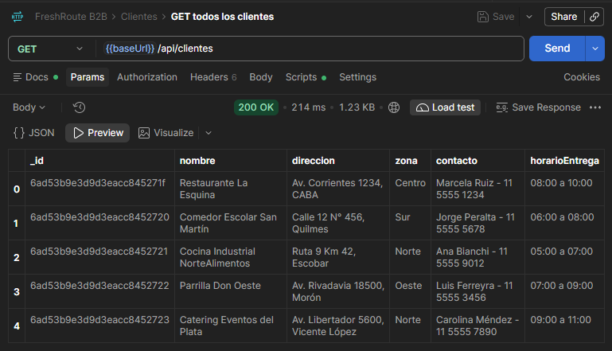

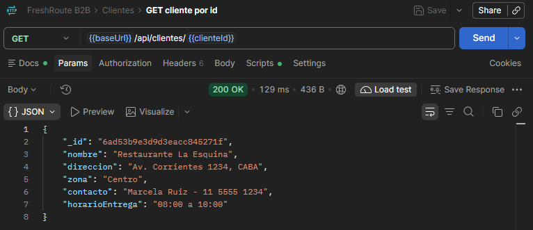

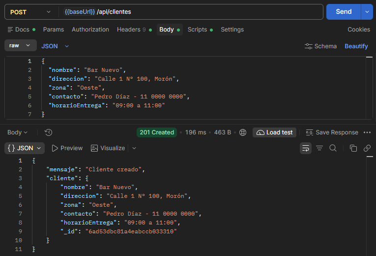

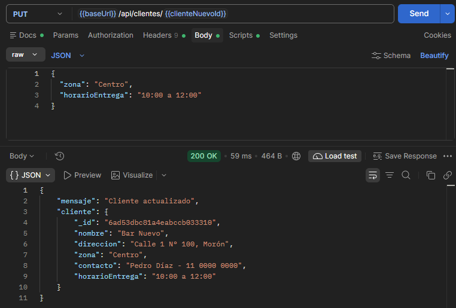

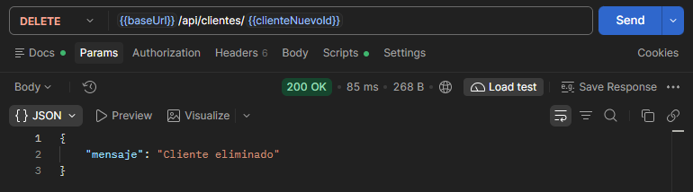

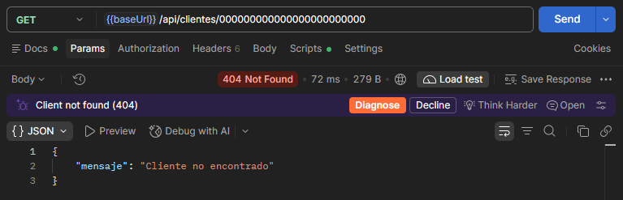

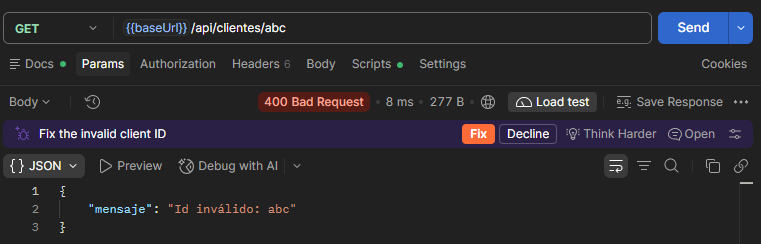

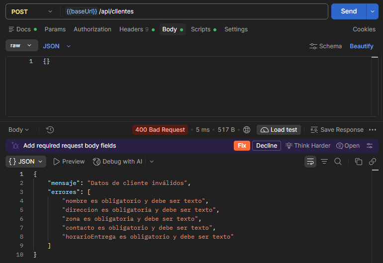

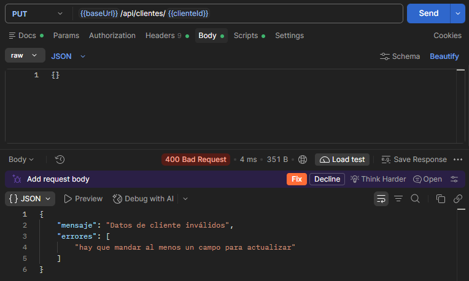

**Módulo Pedidos**

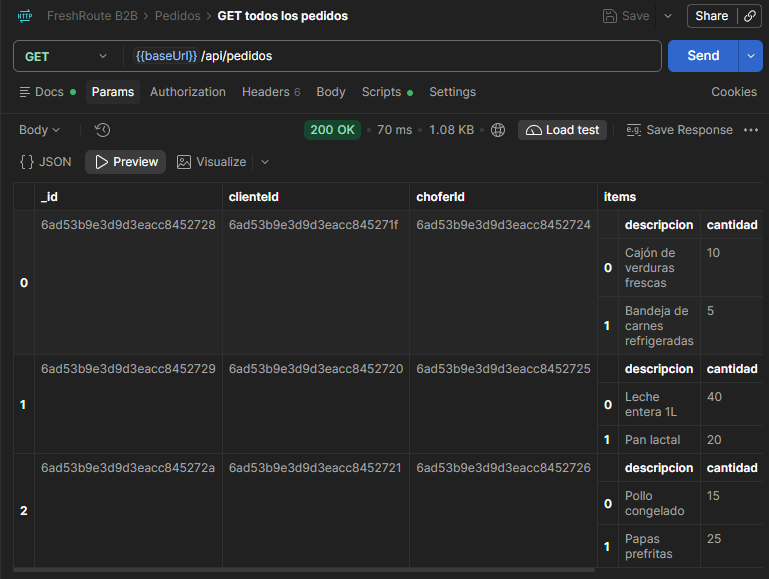

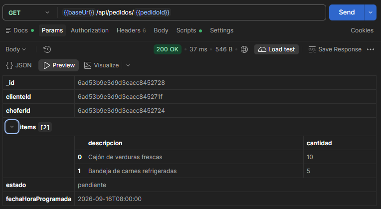

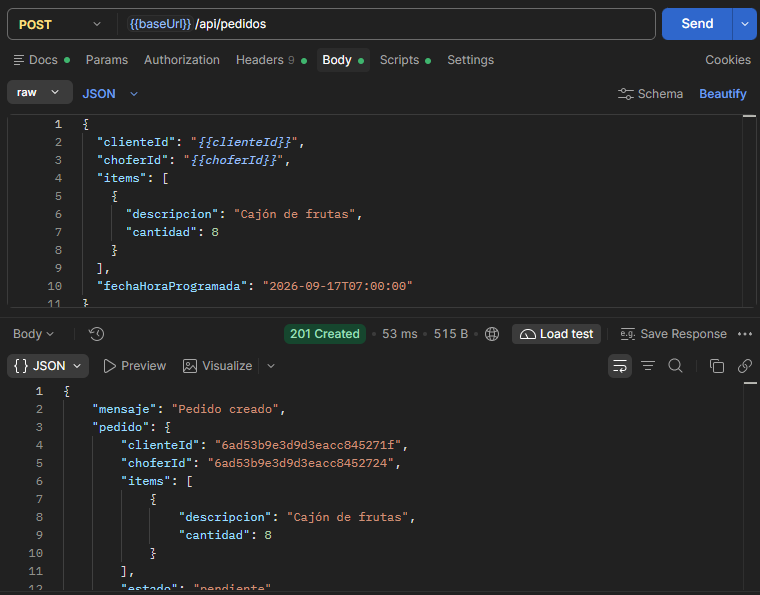

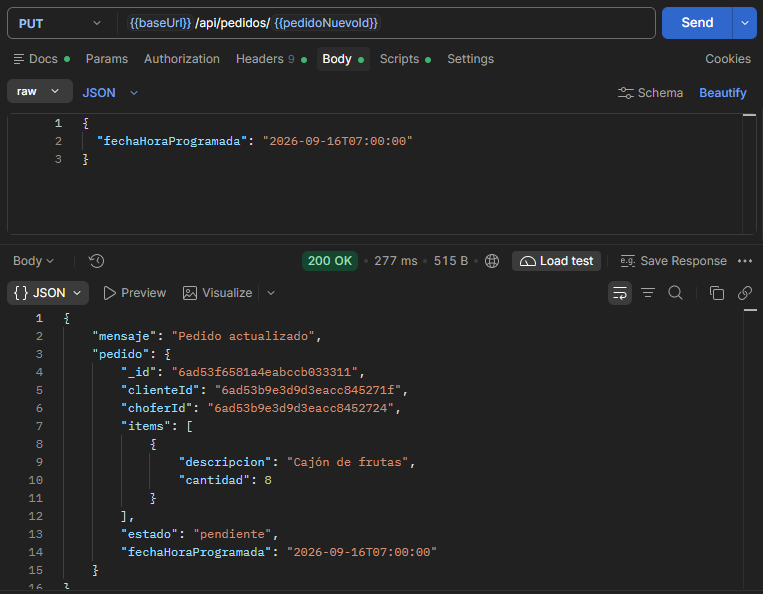

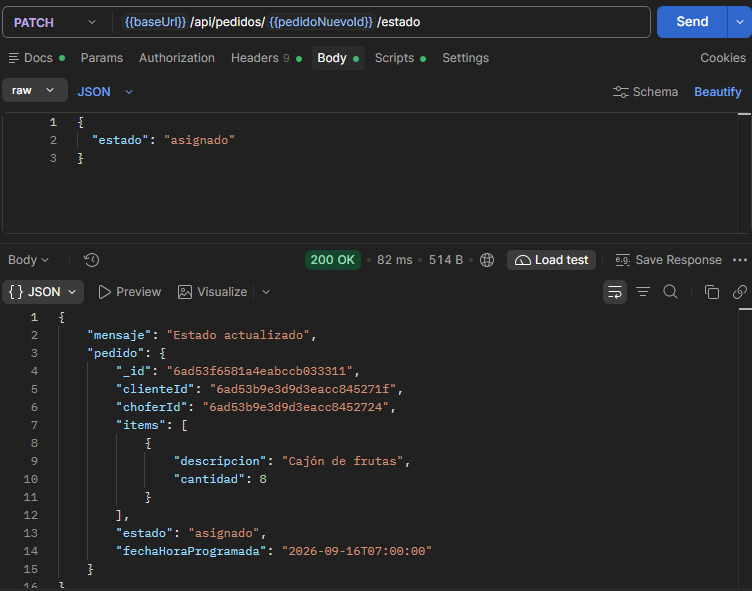

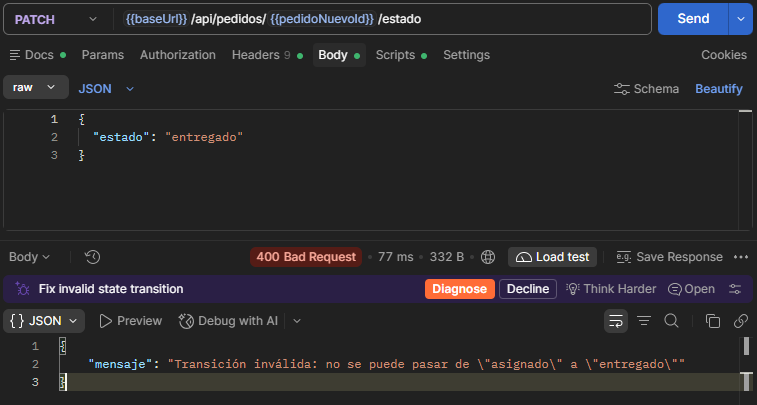

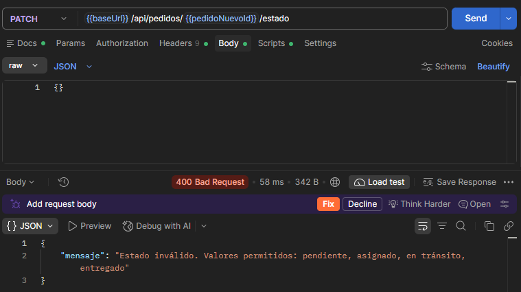

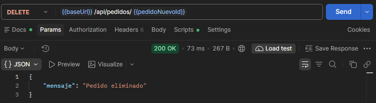

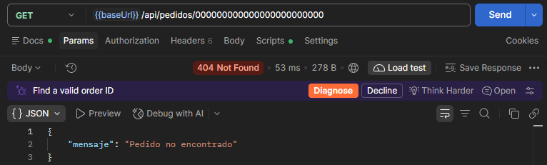

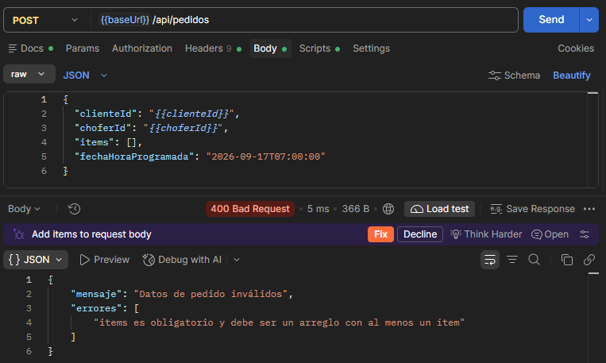

**Choferes (solo lectura)**

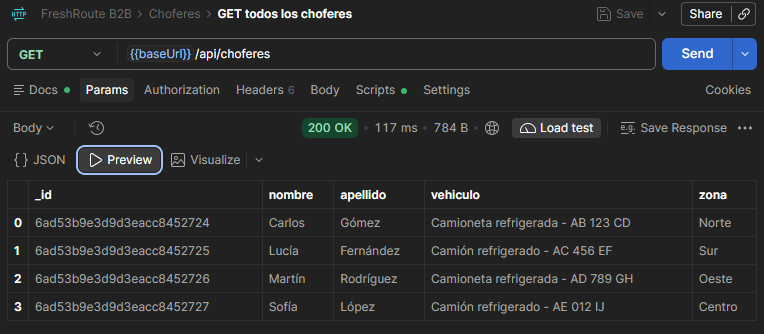

**Manejo de errores**

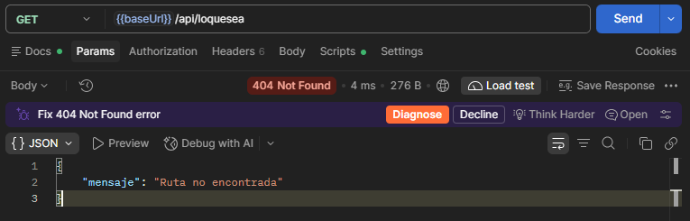

---

## 9. Video

Video explicando el código con MongoDB (grabado por Meet/Zoom, sin edición): <<COMPLETAR: link>>

Orden sugerido (una parte por integrante, según la sección 4):

1. **Nicolás Zalazar** — `.env` y `config/db.js`, arranque en `app.js`, `npm run seed` y cómo se ven las colecciones en MongoDB Compass / Atlas.
2. **Laura Olivera** — schema `Cliente` y el CRUD de clientes con `async/await`.
3. **Christian Albornoz** — schema `Pedido` con referencias, `populate` en las vistas y el formulario de edición.
4. **Laura Belén Blanco** — `PedidoService` (existencia y transiciones) y cómo el `errorHandler` responde a los errores de Mongoose.
5. **Fernando Guevara** — demo en Postman (Run collection) y smoke test.
