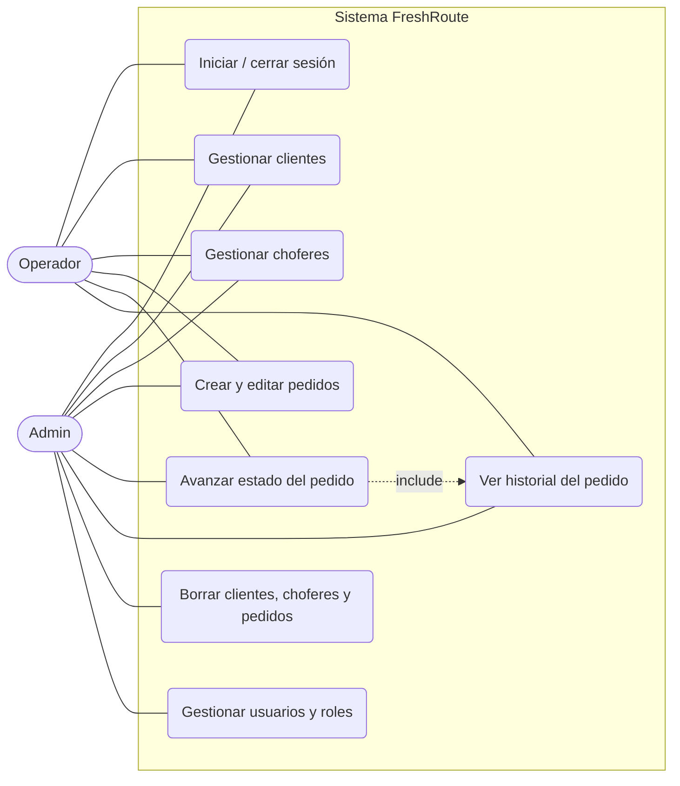
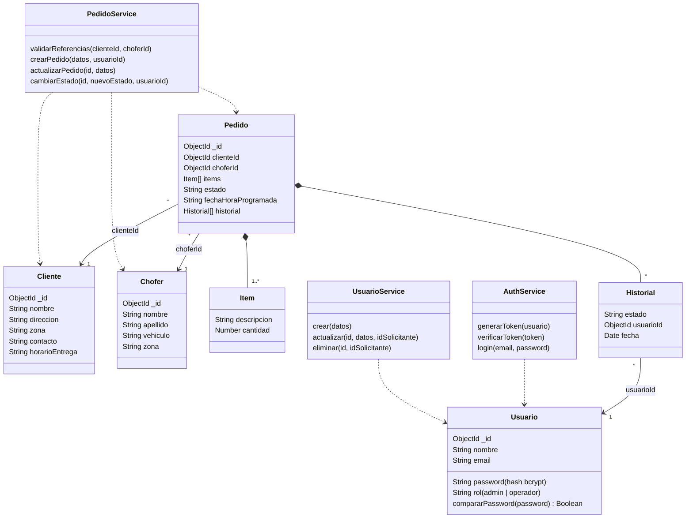
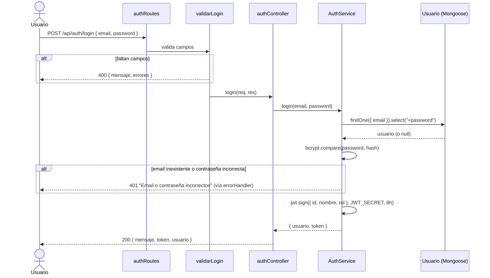
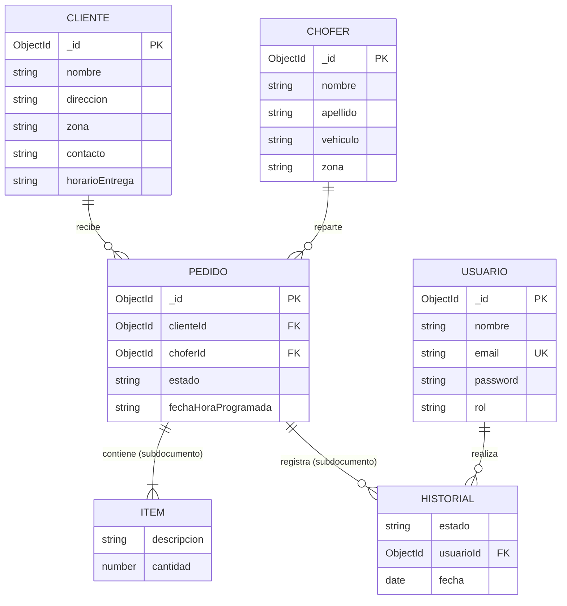
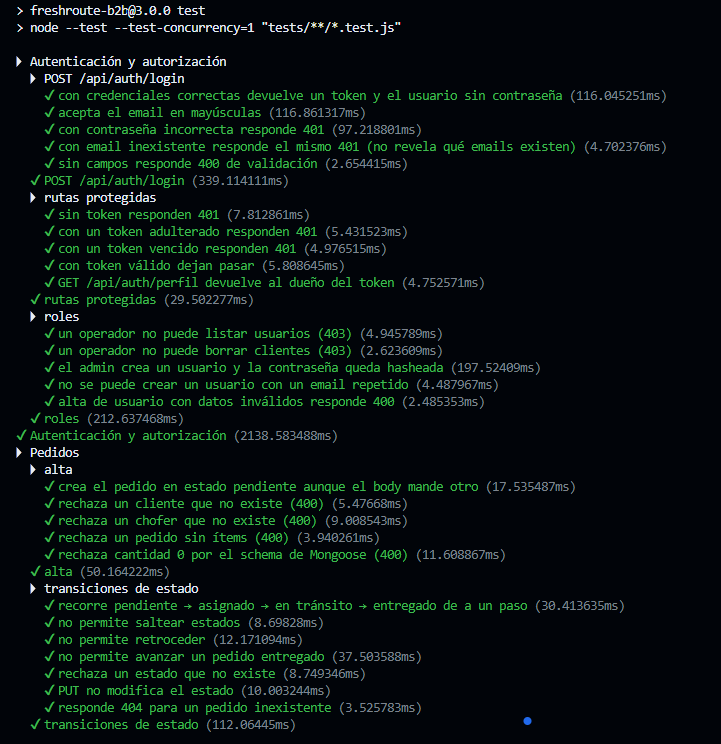
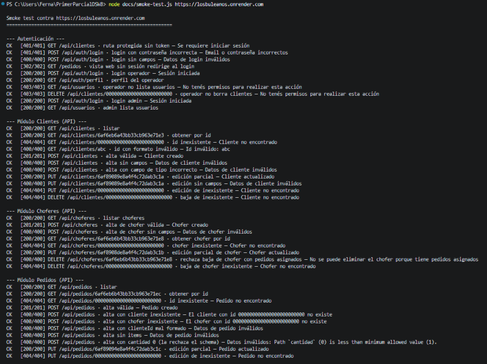
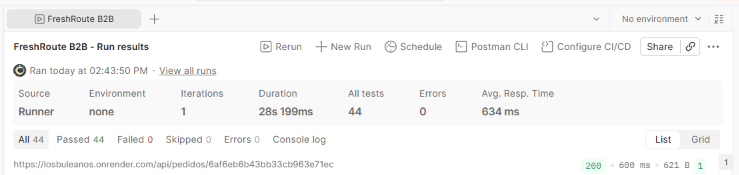
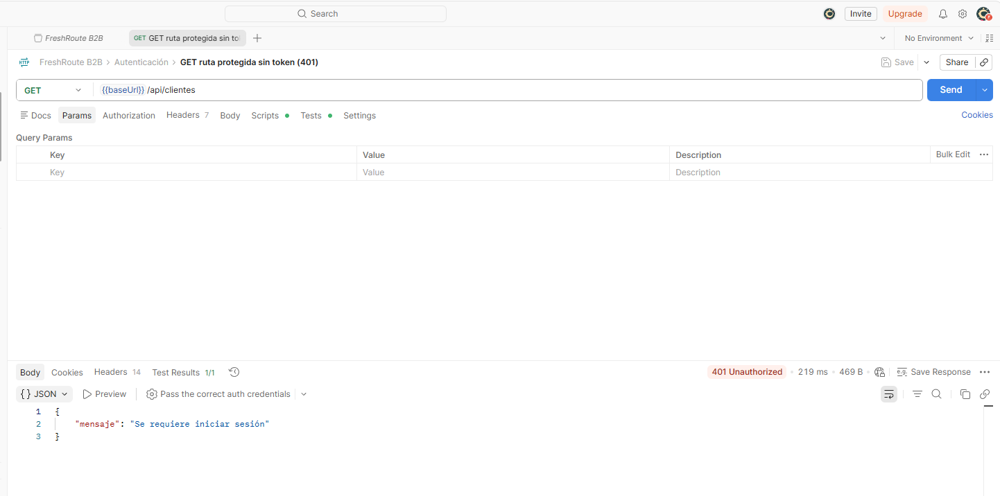
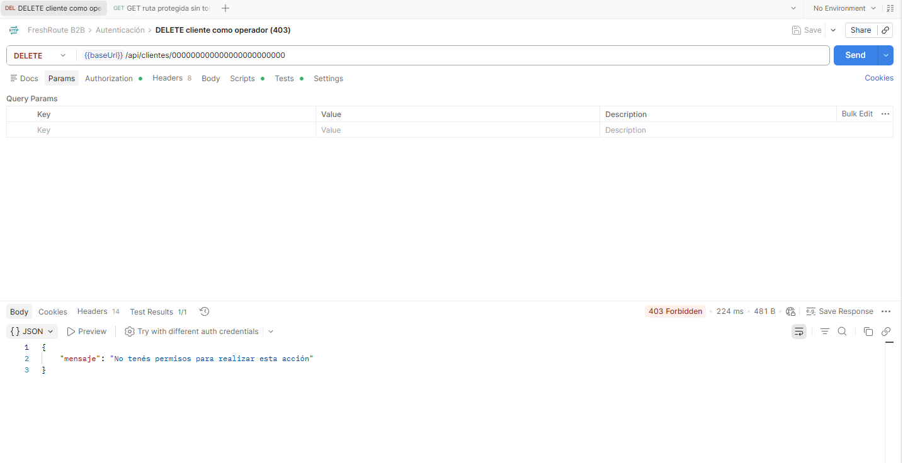

<!--
Fuente del PDF de la entrega final (tercer parcial). Mismo formato que las partes 1 y 2 (portada con logos, links y capturas embebidas).
Exportar el PDF con el mismo nombre que la carpeta de Drive (confirmar el nombre: ver la sección 1).

BORRADOR. Lo que falta completar está marcado con  ⚠️ COMPLETAR  (buscar ese texto antes de exportar).
Los diagramas están en Mermaid: al exportar a PDF, usar una herramienta que los renderice
(por ejemplo, la extensión "Markdown PDF" de VS Code con soporte Mermaid, o pegarlos en https://mermaid.live y exportar como imagen).
-->

 

# DOCUMENTACIÓN - Entrega Final

**Desarrollo de Sistemas Web (Back End) — 2° cuatrimestre 2026 — Tercer Parcial (Entrega Final)**

**Caso 2: Distribución de Pedidos — “FreshRoute”** (FreshRoute B2B — logística de distribución refrigerada)

**Empresa de Desarrollo: LosBuleanos**

**Integrantes:**

- Nicolás Zalazar
- Laura Olivera
- Christian Albornoz
- Laura Belén Blanco
- Fernando Guevara

**Nombre del documento / carpeta Drive:** `DSWB_2A_grupo17-parcial3_2C26` ⚠️ COMPLETAR (confirmar el nombre)

---

## Índice

1. Links
2. Introducción
3. Objetivos
4. Requerimientos
5. Planificación
6. Diagramas
7. Funcionamiento de la aplicación
8. Persistencia de datos — MongoDB Atlas
9. Mantenimiento y evolución
10. Librerías nuevas y decisiones técnicas
11. Pruebas
12. Roles y responsabilidades
13. Uso de inteligencia artificial
14. Bibliografía
15. Conclusión
16. Video y entrega

---

## 1. Links

| Recurso | Link |
|---|---|
| Aplicación en línea (Render + MongoDB Atlas) | https://losbuleanos.onrender.com |
| Repositorio GitHub | https://github.com/Nicoalazar/PrimerParcialDSWB (versión final en `main` y en el tag `v3.0-tercer-parcial`; versiones anteriores en los tags `v2.0-segundo-parcial` y `v1.0-primer-parcial`) |
| Tablero del proyecto (GitHub Projects) | https://github.com/users/Nicoalazar/projects/13 |
| Carpeta Drive | ⚠️ COMPLETAR |
| Video explicativo | ⚠️ COMPLETAR (con permisos de visualización configurados) |

**Usuarios para probar la aplicación en línea:**

| Email | Contraseña | Rol |
|---|---|---|
| `admin@freshroute.test` | `admin123` | `admin` |
| `operador@freshroute.test` | `operador123` | `operador` |

> El servicio está en el plan gratuito de Render: si no se usó en los últimos minutos, la primera visita puede tardar cerca de un minuto en responder.

---

## 2. Introducción

**FreshRoute B2B** es una empresa ficticia de logística refrigerada que reparte insumos a restaurantes, comedores escolares y cocinas industriales. A lo largo del cuatrimestre desarrollamos su backend en tres etapas:

| Versión | Entrega | Qué incorporó |
|---|---|---|
| `v1.0-primer-parcial` | Primer parcial | Node.js + Express 5 con MVC, vistas Pug, módulos Clientes y Pedidos, persistencia en archivos JSON |
| `v2.0-segundo-parcial` | Segundo parcial | Migración de la persistencia a MongoDB con Mongoose (schemas, validaciones, referencias y `populate`) |
| `v3.0-tercer-parcial` | Entrega final | Autenticación y autorización con JWT, gestión de usuarios, CRUD de choferes, historial de estados, despliegue en Render con MongoDB Atlas y tests automáticos |

Esta entrega final **mejora la versión 2.0** siguiendo la consigna: agrega autenticación y autorización, despliega la aplicación en línea con MongoDB Atlas, suma pruebas automáticas de lo crítico y corrige problemas encontrados en el camino. Todos los cambios respecto de la v2.0 están detallados en las secciones 7 y 9.

---

## 3. Objetivos

**Objetivo general.** Centralizar la gestión de los pedidos de distribución refrigerada de FreshRoute —clientes, choferes, pedidos y el avance de cada entrega— en una aplicación web segura, desplegada en línea y con los datos en la nube.

**Objetivos específicos de esta entrega:**

- Restringir el acceso a usuarios autenticados y diferenciar permisos por rol (`admin` y `operador`).
- Registrar quién y cuándo cambió el estado de cada pedido (historial).
- Completar el módulo de Choferes, que en la v2.0 era de solo lectura.
- Permitir que el administrador gestione los usuarios del sistema desde la web.
- Desplegar la aplicación en Render con la base en MongoDB Atlas.
- Cubrir con tests automáticos las reglas de negocio y de seguridad más críticas.
- Separar la configuración en variables de entorno y documentar todo en el README.

---

## 4. Requerimientos

### 4.1 Requerimientos funcionales

| Id | Requerimiento | Rol |
|---|---|---|
| RF01 | Iniciar y cerrar sesión con email y contraseña (API y web) | Todos |
| RF02 | Consultar el propio perfil | Todos |
| RF03 | Dar de alta, listar, editar y borrar usuarios; asignarles un rol | `admin` |
| RF04 | Listar, consultar, crear y editar clientes | `admin`, `operador` |
| RF05 | Borrar clientes | `admin` |
| RF06 | Listar, consultar, crear y editar choferes | `admin`, `operador` |
| RF07 | Borrar choferes, solo si no tienen pedidos asignados | `admin` |
| RF08 | Crear pedidos con cliente, chofer, ítems y fecha programada; validar que el cliente y el chofer existan | `admin`, `operador` |
| RF09 | Avanzar el estado de un pedido de a un paso: `pendiente → asignado → en tránsito → entregado` (sin saltos ni retrocesos) | `admin`, `operador` |
| RF10 | Registrar en cada pedido el historial de estados con el usuario y la fecha | Sistema |
| RF11 | Editar los datos de un pedido sin modificar su estado | `admin`, `operador` |
| RF12 | Borrar pedidos | `admin` |
| RF13 | Operar todo lo anterior desde una interfaz web (Pug) y desde una API JSON | Todos |

### 4.2 Requerimientos no funcionales

| Id | Tipo | Requerimiento | Cómo se cumple |
|---|---|---|---|
| RNF01 | Seguridad | Las contraseñas nunca se guardan ni se devuelven en texto plano | Hash con bcrypt en el `pre("save")` del modelo; `select: false` y `toJSON` que la borra |
| RNF02 | Seguridad | Toda la API salvo el login exige autenticación; las acciones sensibles exigen rol `admin` | Middlewares `requiereLogin` / `requiereLoginWeb` y `autorizar("admin")` |
| RNF03 | Seguridad | El token no puede leerse desde JavaScript del navegador | En la web el JWT viaja en una cookie `httpOnly`, `sameSite=lax` y `secure` en producción |
| RNF04 | Seguridad | Un usuario borrado o con el rol cambiado pierde los permisos en el momento | `verificarUsuarioActivo` consulta la base en cada request autenticado |
| RNF05 | Seguridad | Los datos sensibles de configuración no están en el repositorio | Variables de entorno (`.env` en `.gitignore`, plantilla en `.env.example`) |
| RNF06 | Seguridad | Los mensajes de error no exponen detalles internos | El `errorHandler` responde "Error interno del servidor" en los 500; el login responde el mismo mensaje exista o no el email |
| RNF07 | Disponibilidad | La aplicación está accesible en línea | Render (web service) + MongoDB Atlas |
| RNF08 | Mantenibilidad | Código organizado en MVC, reglas de negocio en services y sin lógica duplicada entre la API y la web | Ver sección 7.1 |
| RNF09 | Confiabilidad | Las reglas críticas tienen pruebas automáticas que no dependen de una base externa | `node:test` + `supertest` + MongoDB en memoria (sección 11) |
| RNF10 | Usabilidad | Los errores en la web se muestran en una página legible, no como JSON | `views/error.pug` con la lista de errores de validación |
| RNF11 | Integridad | No se pueden crear pedidos con referencias inexistentes ni borrar choferes con pedidos | `PedidoService.validarReferencias` y chequeo en `eliminarChofer` |

---

## 5. Planificación

El trabajo se organizó en un **tablero de GitHub Projects** con un issue por tarea, cada uno con su responsable, y un milestone "Entrega final". Cada tarea se desarrolló en su propia rama y entró a `main` por pull request con revisión.

 ⚠️ COMPLETAR (sacar la captura del tablero en vista Board y guardarla como `docs/evidencia/parcial3/tablero.png`)

### 5.1 Historias de usuario

Prioridad en formato MoSCoW: **M** (must, obligatorio por la consigna), **S** (should, mejora importante), **C** (could, deseable).

| Id | Historia de usuario | Prioridad | Estimación | Issue / PR |
|---|---|---|---|---|
| HU01 | Como **usuario del sistema** quiero iniciar sesión para que solo el personal de FreshRoute acceda a los datos | M | ⚠️ COMPLETAR | PR #34 |
| HU02 | Como **admin** quiero que solo yo pueda borrar registros para evitar bajas por error | M | ⚠️ COMPLETAR | PR #34 |
| HU03 | Como **equipo** queremos la aplicación desplegada en línea con la base en la nube para poder mostrarla sin instalar nada | M | ⚠️ COMPLETAR | #38 / PR #45 |
| HU04 | Como **equipo** queremos tests automáticos de lo crítico para detectar errores antes de mergear | M | ⚠️ COMPLETAR | PR #34, #39 / PR #48 |
| HU05 | Como **operador** quiero gestionar los choferes (alta, edición) para mantener actualizada la flota | S | ⚠️ COMPLETAR | #36 / PR #50 |
| HU06 | Como **operador** quiero ver quién y cuándo cambió el estado de un pedido para hacer el seguimiento de la entrega | S | ⚠️ COMPLETAR | #37 / PR #50 |
| HU07 | Como **admin** quiero gestionar los usuarios desde la web (alta, edición, baja, rol) sin usar Postman | S | ⚠️ COMPLETAR | #44 / PR #51 |
| HU08 | Como **usuario** quiero ver los errores de los formularios en una página legible | C | ⚠️ COMPLETAR | #41 / PR #46 |
| HU09 | Como **equipo** queremos las dependencias sin vulnerabilidades conocidas | S | ⚠️ COMPLETAR | #40 / PR #47 |
| HU10 | Como **equipo** queremos documentar todo y entregar las dos versiones | M | ⚠️ COMPLETAR | #42, #43 |

### 5.2 Orden de trabajo

1. Autenticación, roles, configuración y tests (PR #34). Bloqueaba al resto.
2. En paralelo: dependencias (#40), errores web (#41), choferes (#36), historial (#37), usuarios (#44) y deploy (#38).
3. Pruebas contra la base real y el deploy, con evidencia (#39).
4. Documentación (#42) y cierre: tag, ZIP + RAR y video (#43).

---

## 6. Diagramas

> Los diagramas están en Mermaid y se generaron a partir del código; ⚠️ COMPLETAR: revisarlos en equipo antes de exportar.

### 6.1 Casos de uso



El **admin** puede hacer todo lo del operador y, además, borrar registros y gestionar usuarios.

### 6.2 Diagrama de clases (modelos y services)



### 6.3 Diagrama de secuencia — Login (API)



En la web el flujo es el mismo (`POST /login` usa el mismo `AuthService`), pero el token se guarda en una cookie `httpOnly` y se redirige a `/pedidos`.

### 6.4 Diagrama de secuencia — Cambio de estado de un pedido

```mermaid
sequenceDiagram
    actor U as Operador
    participant A as cargarUsuario + verificarUsuarioActivo
    participant L as requiereLogin
    participant C as pedidosController
    participant S as PedidoService
    participant M as Pedido (Mongoose)

    U->>A: PATCH /api/pedidos/:id/estado { estado } + Bearer token
    A->>A: jwt.verify(token) y Usuario.findById(id)
    A->>L: req.usuario = { id, nombre, rol }
    alt sin token, token inválido o usuario borrado
        L-->>U: 401
    end
    L->>C: cambiarEstado(req, res)
    C->>S: cambiarEstado(id, estado, req.usuario.id)
    S->>M: findById(id)
    alt no existe
        S-->>U: 404 "Pedido no encontrado"
    end
    alt estado inválido, salto o retroceso
        S-->>U: 400 "Transición inválida…"
    end
    S->>M: estado = nuevo; historial.push({ estado, usuarioId, fecha })
    S->>M: save()
    S-->>C: pedido
    C-->>U: 200 { mensaje: "Estado actualizado", pedido }
```

### 6.5 Modelo de datos (ER)



`ITEM` e `HISTORIAL` no son colecciones: son **subdocumentos** embebidos dentro de cada pedido.

---

## 7. Funcionamiento de la aplicación

### 7.1 Arquitectura y estructura de carpetas (MVC)

```
server.js        → punto de entrada: conecta a MongoDB y recién ahí levanta el servidor
app.js           → arma la app de Express (middlewares y rutas) y la exporta (la usan server.js y los tests)
config/          → variables de entorno centralizadas (index.js) y conexión a MongoDB (db.js)
routes/api/      → rutas JSON  → /api/auth, /api/usuarios, /api/clientes, /api/choferes, /api/pedidos
routes/web/      → rutas Pug   → /login, /logout, /clientes, /choferes, /pedidos, /usuarios
controllers/     → manejo de cada request
services/        → reglas de negocio: PedidoService, AuthService, UsuarioService
models/          → schemas de Mongoose: Usuario, Cliente, Chofer, Pedido
middlewares/     → logger, autenticación/autorización, usuario activo, validación, errores y 404
views/           → vistas Pug
tests/           → tests automáticos
seed.js, data/   → carga de datos de ejemplo (npm run seed)
```

Cada módulo tiene **dos capas de rutas sobre la misma lógica**: `routes/api` responde JSON (se prueba con Postman) y `routes/web` renderiza las vistas Pug. Como los formularios HTML solo envían `GET` y `POST`, la web usa `POST /:id/editar` y `POST /:id/eliminar` en lugar de `PUT` y `DELETE`. Las dos capas usan los mismos validadores, controllers y services, así que las reglas de negocio no se duplican.

### 7.2 Recorrido de un request

`logger` → `express.json / urlencoded` → `cookieParser` → `static` → `cargarUsuario` → `verificarUsuarioActivo` → `requiereLogin` → `routes` → (`autorizar`) → (`validate`) → `controller` → (`service`) → modelo de Mongoose → MongoDB

1. `logger` registra método, URL y hora.
2. `cargarUsuario` busca el JWT en el header `Authorization: Bearer` (API) o en la cookie `token` (web); si es válido, deja `{ id, nombre, rol }` en `req.usuario`.
3. `verificarUsuarioActivo` confirma en la base que ese usuario existe y toma su rol actual.
4. `requiereLogin` (API → `401`) o `requiereLoginWeb` (web → redirige a `/login`) cortan si no hay sesión.
5. `autorizar("admin")` responde `403` si el rol no alcanza.
6. Los validadores revisan el body; si algo falla responden `400 { mensaje, errores }` (o la página de error en la web).
7. El controller, sin `try/catch`, llama al service o al modelo. Cualquier error lanzado (con `statusCode`, `CastError` o `ValidationError` de Mongoose) lo recibe automáticamente el `errorHandler` de Express 5, que responde JSON en `/api` o renderiza `error.pug` en la web.

### 7.3 Autenticación y autorización

- **Login:** `POST /api/auth/login` verifica la contraseña con bcrypt y devuelve un **JWT** firmado con `JWT_SECRET`, que vence a las 8 horas (`JWT_EXPIRES_IN`). Para no revelar qué emails existen, el error es el mismo si el email no existe o si la contraseña es incorrecta.
- **API:** el token se envía en `Authorization: Bearer <token>`.
- **Web:** el formulario `/login` usa el mismo `AuthService` y guarda el token en una cookie `httpOnly` (el JavaScript del navegador no puede leerla). `POST /logout` la borra.
- **Roles:**

| Acción | `operador` | `admin` |
|---|---|---|
| Ver, crear y editar clientes, choferes y pedidos | ✅ | ✅ |
| Avanzar el estado de un pedido | ✅ | ✅ |
| Borrar clientes, choferes y pedidos | ❌ `403` | ✅ |
| Gestionar usuarios | ❌ `403` | ✅ |

  En la web, el operador directamente no ve los botones de eliminar ni el menú de usuarios; si fuerza el request, el backend responde `403` igual.
- **No hay registro abierto:** es un sistema interno, así que los usuarios los da de alta un admin.

**Lo que no usamos y por qué:**

- **Sesiones en el servidor (`express-session`):** elegimos JWT porque es *stateless* (el servidor no guarda sesiones), sirve igual para la API y para la web, y no necesita una colección extra en la base.
- **Passport:** con un solo método de login (email y contraseña) agregaba una capa más sin aportar nada; la lógica de autenticación entra en un service de unas 40 líneas que el equipo puede explicar completo.
- **OAuth / login con terceros:** fuera del alcance de un sistema interno B2B.

### 7.4 Módulos

| Módulo | API | Web | Notas |
|---|---|---|---|
| Autenticación | `POST /api/auth/login`, `GET /api/auth/perfil` | `/login`, `/logout` | |
| Usuarios (solo admin) | `GET`, `POST`, `PUT`, `DELETE` en `/api/usuarios` | `/usuarios` | El admin no puede borrarse ni sacarse su propio rol; la contraseña se vuelve a hashear al editarla |
| Clientes | CRUD en `/api/clientes` | `/clientes` | |
| Choferes | CRUD en `/api/choferes` | `/choferes` | No se puede borrar un chofer con pedidos asignados |
| Pedidos | CRUD en `/api/pedidos` + `PATCH /api/pedidos/:id/estado` | `/pedidos` | Estados de a un paso; historial con usuario y fecha |

La tabla completa de endpoints, con bodies y respuestas de ejemplo, está en el `README.md` del repositorio.

### 7.5 Variables de entorno y configuración

Todas las variables se leen en un único archivo, `config/index.js`; el resto del código importa `config`. Si falta `JWT_SECRET`, la aplicación no arranca.

| Variable | Uso |
|---|---|
| `PORT` | Puerto del servidor (en Render la define la plataforma) |
| `NODE_ENV` | En `production` la cookie de sesión se marca `secure` (solo HTTPS) |
| `MONGO_URI` | Conexión a MongoDB Atlas (cada integrante tiene su propia base de desarrollo) |
| `JWT_SECRET` | Secreto para firmar los tokens (distinto en desarrollo y en producción) |
| `JWT_EXPIRES_IN` | Duración del token (`8h`) |

---

## 8. Persistencia de datos — MongoDB Atlas

La base está en un **cluster gratuito (M0) de MongoDB Atlas**, con bases separadas para no pisarse los datos:

| Base | Uso |
|---|---|
| `freshroute` | Producción (la usa la aplicación desplegada en Render) |
| `freshroute_<integrante>` | Una por integrante para desarrollar y probar |

Cada integrante y el deploy tienen su propio usuario de Atlas con permiso `readWrite` solo sobre su base.

| Colección | Modelo | Campos principales | Seed |
|---|---|---|---|
| `usuarios` | `Usuario` | `nombre`, `email` (único), `password` (hash), `rol` | 2 |
| `clientes` | `Cliente` | `nombre`, `direccion`, `zona`, `contacto`, `horarioEntrega` | 5 |
| `choferes` | `Chofer` | `nombre`, `apellido`, `vehiculo`, `zona` | 4 |
| `pedidos` | `Pedido` | `clienteId` (ref), `choferId` (ref), `items[]`, `estado`, `fechaHoraProgramada`, `historial[]` | 3 |

**Schema de Pedido (resumen):**

```js
const historialSchema = new mongoose.Schema({
    estado: { type: String, enum: ESTADOS, required: true },
    usuarioId: { type: mongoose.Schema.Types.ObjectId, ref: "Usuario" },
    fecha: { type: Date, default: Date.now }
}, { _id: false });

const pedidoSchema = new mongoose.Schema({
    clienteId: { type: mongoose.Schema.Types.ObjectId, ref: "Cliente", required: true },
    choferId: { type: mongoose.Schema.Types.ObjectId, ref: "Chofer", required: true },
    items: { type: [itemSchema], validate: (items) => items.length > 0 },
    estado: { type: String, enum: ESTADOS, default: "pendiente" },
    fechaHoraProgramada: { type: String, required: true },
    historial: [historialSchema]
});
```

`npm run seed` vacía las cuatro colecciones y las vuelve a cargar desde `/data`. Los usuarios se insertan con `Usuario.create` para que pase por el `pre("save")` que hashea la contraseña.

---

## 9. Mantenimiento y evolución

Cambios respecto de la v2.0, agrupados por objetivo:

### Seguridad

- **Autenticación y autorización** con JWT y roles (antes cualquiera podía usar la API y la web).
- **Contraseñas hasheadas con bcrypt** y nunca devueltas en las respuestas.
- **Cookie `httpOnly` y `secure`** para el token en la web.
- **Usuarios borrados pierden el acceso en el momento:** antes de `verificarUsuarioActivo`, un token seguía sirviendo hasta vencer aunque el usuario se hubiera borrado; además, un cambio de rol ahora aplica de inmediato.
- **Errores 500 sin detalles internos** para el cliente (el detalle queda en el log del servidor).
- **Dependencias vulnerables actualizadas** (`body-parser` y `proxy-addr`, internas de Express): `npm audit --omit=dev` quedó sin vulnerabilidades. Quedan avisos moderados de `minimatch` que vienen por `nodemon` y solo afectan al entorno de desarrollo; arreglarlos obligaba a bajar `nodemon` de versión.
- **Los ids nunca se toman del body**, ni el usuario del historial (sale siempre del token).

### Corrección de errores

- Los errores de validación de los **formularios web** se mostraban como JSON crudo en el navegador; ahora se muestra una página con la lista de errores.
- En la revisión del CRUD de choferes se corrigieron: respuestas con un formato distinto al resto de la API, rutas documentadas que no existían, `try/catch` que convertían un id mal formado en error 500, y la posibilidad de crear un chofer con un `_id` elegido por el cliente.
- En el historial de estados, el usuario no se guardaba (se leía `req.usuario._id` cuando el token guarda `id`); se corrigió y se agregaron tests.

### Escalabilidad y rendimiento

- **Configuración separada en variables de entorno** (`config/index.js`), con valores distintos para desarrollo y producción.
- **`app.js` separado de `server.js`:** la app se puede probar sin levantar un servidor ni conectarse a una base real.
- **Base en la nube (Atlas)** con bases separadas por integrante y para producción.
- **Compromiso consciente de rendimiento:** `verificarUsuarioActivo` agrega una consulta a la base por cada request autenticado. Lo aceptamos a cambio de que los permisos estén siempre actualizados; con el volumen de esta aplicación el impacto es mínimo.
- **`populate` acotado:** del usuario del historial solo se trae el nombre, no el documento completo.

### Limitaciones conocidas

- En Atlas el acceso de red está abierto a `0.0.0.0/0` porque Render (plan gratuito) no tiene una IP fija. La protección queda en los usuarios y contraseñas de la base.
- El plan gratuito de Render "duerme" el servicio sin uso, así que la primera visita puede tardar cerca de un minuto.
- No hay recuperación de contraseña por email ni límite de intentos de login.

---

## 10. Librerías nuevas y decisiones técnicas

Librerías que no se vieron en clase y por qué las sumamos:

| Librería | Para qué | Por qué |
|---|---|---|
| `jsonwebtoken` | Firmar y verificar los JWT | Es la implementación estándar de JWT en Node.js; la consigna sugiere JWT |
| `bcryptjs` | Hashear y comparar contraseñas | Guardar contraseñas en texto plano es inaceptable; `bcryptjs` no necesita compilar código nativo, así que se instala igual en Windows y en Render |
| `cookie-parser` | Leer la cookie del token en la web | Middleware oficial de Express para leer cookies |
| `supertest` (dev) | Enviar requests a la app en los tests sin abrir un puerto | Se integra directo con la app de Express exportada por `app.js` |
| `mongodb-memory-server` (dev) | Levantar una MongoDB temporal en cada archivo de tests | Los tests no dependen de tener Mongo instalado y nunca tocan la base de desarrollo ni la de Atlas |

Para los tests usamos el runner que trae Node (`node:test` y `node:assert`), así que no hizo falta un framework de testing extra.

---

## 11. Pruebas

Usamos tres niveles de prueba. La evidencia completa está en `docs/evidencia/parcial3/`.

### 11.1 Tests automáticos (`npm test`)

- **Objetivo:** verificar las reglas de negocio y de seguridad más críticas en cada cambio, antes de mergear.
- **Procedimiento:** `node:test` + `supertest`; cada archivo levanta su propia MongoDB en memoria y carga datos de prueba.
- **Resultado:** **78 tests, 78 OK** ⚠️ COMPLETAR (actualizar la captura: la de `tests_locales_*.png` se tomó con 39 tests).

| Archivo | Tests | Qué cubre |
|---|---|---|
| `tests/auth.test.js` | 15 | Login correcto e incorrecto, token ausente, vencido o adulterado, perfil, permisos por rol, alta de usuarios con hash |
| `tests/usuarios.test.js` | 20 | Edición y baja de usuarios, re-hash de la contraseña, el admin no se borra ni se saca el rol, usuario borrado pierde el acceso |
| `tests/pedidos.test.js` | 17 | Nace en `pendiente`, cliente/chofer inexistentes, ítems inválidos, transiciones sin saltos ni retrocesos, historial con el usuario del token, `PUT` no toca el estado, baja solo admin |
| `tests/choferes.test.js` | 12 | CRUD, 404 e id inválido, `_id` del body ignorado, operador no borra, no se borra un chofer con pedidos |
| `tests/web.test.js` | 14 | Redirección al login, cookie `httpOnly`, botones según rol, 403 en la web, página de error, historial al avanzar el estado desde la web |



### 11.2 Smoke test (`node docs/smoke-test.js`)

- **Objetivo:** recorrer la aplicación completa de punta a punta, como un usuario, contra una base real.
- **Procedimiento:** con el servidor levantado y el seed cargado, el script hace login y recorre autenticación, los cuatro módulos, las transiciones de estado, los errores y las vistas web; crea y borra sus propios registros.
- **Resultado:** **64 OK · 0 fallas**, tanto local contra Atlas como contra el deploy en Render ⚠️ COMPLETAR (actualizar las capturas: las actuales son de cuando el smoke test tenía 55 verificaciones).



### 11.3 Colección Postman

- **Objetivo:** probar cada endpoint de la API, incluidos los casos de error, y dejar evidencia.
- **Procedimiento:** `docs/api-collection.postman.json`, corrida completa en orden con *Run collection*. La carpeta *Autenticación* hace login y guarda el token, que la colección envía en cada request.
- **Resultado:** ⚠️ COMPLETAR (la corrida guardada en la evidencia es de 31/31 asserts, antes de sumar usuarios y choferes; volver a correrla y capturar).



**Casos de error destacados:**





---

## 12. Roles y responsabilidades

⚠️ COMPLETAR: confirmar en equipo qué hizo realmente cada integrante en esta entrega y qué parte explica en el video. Como referencia, el reparto planificado en `docs/RELEASE_PLAN_Parte3.md` fue:

| Integrante | Responsabilidad planificada | Lo que hizo |
|---|---|---|
| Nicolás Zalazar | Configuración, `server.js`, seed de usuarios, deploy en Render + Atlas | ⚠️ COMPLETAR |
| Laura Olivera | Modelo `Usuario`, login y gestión de usuarios desde la web (#44) | ⚠️ COMPLETAR |
| Christian Albornoz | CRUD de Choferes (#36) e historial de estados (#37) | ⚠️ COMPLETAR |
| Laura Belén Blanco | Middlewares de autenticación y autorización, errores web (#41) y dependencias (#40) | ⚠️ COMPLETAR |
| Fernando Guevara | Tests, evidencia (#39) y documentación (#42) | ⚠️ COMPLETAR |

---

## 13. Uso de inteligencia artificial

⚠️ COMPLETAR: revisar y ajustar esta sección en equipo; tiene que reflejar exactamente cómo se usó.

Usamos **Claude Code** (asistente de programación de Anthropic) como apoyo en el desarrollo y la documentación:

- **Código:** generó la base de la autenticación con JWT, los roles, la configuración centralizada y los tests automáticos (PR #34). También se usó para revisar los pull requests del equipo y corregir lo encontrado en las revisiones (choferes, historial y usuarios).
- **Infraestructura:** guió la configuración de MongoDB Atlas (bases y usuarios separados) y del deploy en Render.
- **Documentación:** redactó partes del README, la evidencia de pruebas y el borrador de este documento, incluidos los diagramas en Mermaid.

**Cómo lo revisamos:** cada cambio entró por pull request y se probó antes de mergear (tests automáticos y smoke test). ⚠️ COMPLETAR: cada integrante describe qué revisó, entendió o modificó de lo generado en su parte, ya que la consigna pide poder explicar todo sin depender de la herramienta.

---

## 14. Bibliografía

**Material de la cátedra**

- Código de clases (Drive del profesor) — https://drive.google.com/drive/folders/18hYfMEMIDmce3HxpmjJRqGdp9KBO9t9j

**Autenticación y seguridad**

- Introducción a JSON Web Tokens — https://jwt.io/introduction
- jsonwebtoken (documentación de la librería) — https://github.com/auth0/node-jsonwebtoken#readme
- bcryptjs — https://github.com/dcodeIO/bcrypt.js#readme
- cookie-parser — https://expressjs.com/en/resources/middleware/cookie-parser.html
- MDN: cookies HTTP (`HttpOnly`, `Secure`, `SameSite`) — https://developer.mozilla.org/es/docs/Web/HTTP/Cookies
- Express: buenas prácticas de seguridad en producción — https://expressjs.com/en/advanced/best-practice-security.html
- OWASP: almacenamiento de contraseñas — https://cheatsheetseries.owasp.org/cheatsheets/Password_Storage_Cheat_Sheet.html

**Pruebas**

- Node.js: test runner (`node:test`) — https://nodejs.org/api/test.html
- supertest — https://github.com/ladjs/supertest#readme
- mongodb-memory-server — https://github.com/typegoose/mongodb-memory-server#readme

**Despliegue**

- Render: deploy de una app Node/Express — https://render.com/docs/deploy-node-express-app
- MongoDB Atlas: crear un cluster gratuito — https://www.mongodb.com/docs/atlas/getting-started/
- MongoDB Atlas: usuarios de base de datos y acceso de red — https://www.mongodb.com/docs/atlas/security/

**Base de los parciales anteriores**

- Express 5 (routing, middleware y manejo de errores) — https://expressjs.com/
- Mongoose (schemas, validación, populate) — https://mongoosejs.com/docs/
- Pug — https://pugjs.org/
- Postman — https://learning.postman.com/docs/
- Mermaid (diagramas de este documento) — https://mermaid.js.org/

El detalle completo está en `docs/bibliografia.md` del repositorio.

---

## 15. Conclusión

⚠️ COMPLETAR: la consigna pide responder estas preguntas. Conviene que cada integrante aporte su respuesta (puede ir un párrafo por persona o una respuesta en conjunto).

**¿Qué aprendimos este cuatrimestre?**

⚠️ COMPLETAR

**¿Qué dificultades tuvimos y cómo las resolvimos?**

⚠️ COMPLETAR (ideas del recorrido: migrar de archivos JSON a MongoDB sin cambiar las rutas; trabajar cinco personas sobre el mismo repo con ramas y pull requests y resolver conflictos; pull requests apuntados a la rama equivocada; configurar Atlas y el deploy).

**¿Qué parte del desarrollo Back End nos interesó más?**

⚠️ COMPLETAR

**¿Qué deberíamos reforzar?**

⚠️ COMPLETAR

---

## 16. Video y entrega

**Video:** ⚠️ COMPLETAR (link con permisos de visualización). Todos los integrantes aparecen en cámara y explican la parte en la que trabajaron, y se muestra la demostración de las pruebas (tests, smoke test y Postman, con casos de error).

**Entrega del código.** Cada integrante sube su propia copia al campus en **ZIP y RAR**, con dos carpetas:

| Carpeta | Contenido |
|---|---|
| `Version 2.0` | Código y documentación del segundo parcial (tag `v2.0-segundo-parcial`) |
| `Version 3.0` | Código y documentación de esta entrega (tag `v3.0-tercer-parcial`) |

Ninguna de las dos incluye `node_modules` ni el archivo `.env`.
